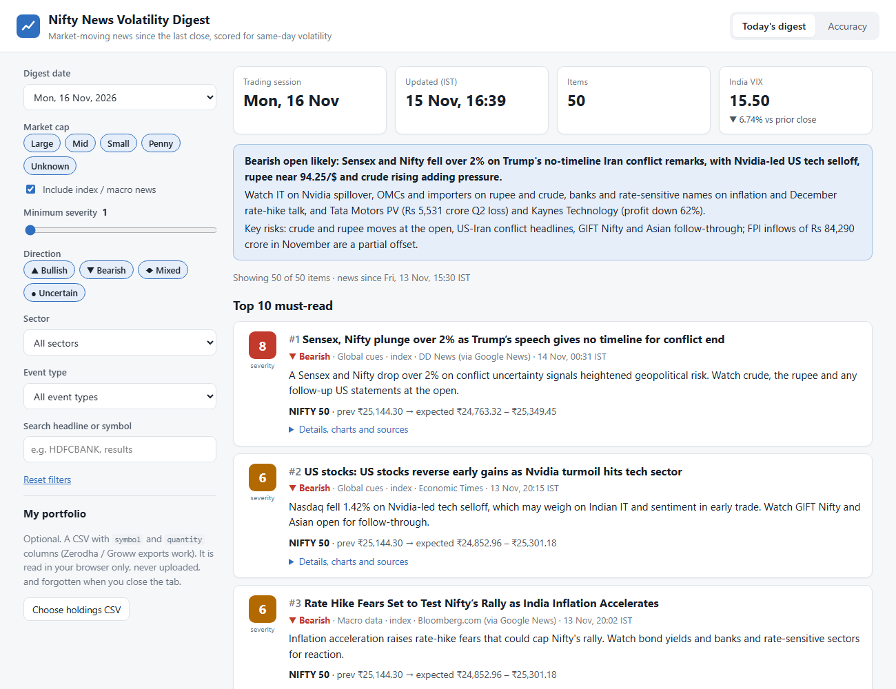

# 📈 Nifty News Volatility Digest

[](https://github.com/deltaupsilon865/nifty-news-volatility-digest-personal/actions/workflows/daily_digest.yml)
[](https://github.com/deltaupsilon865/nifty-news-volatility-digest-personal/actions/workflows/tests.yml)
[](LICENSE)

Every trading morning at **08:00 IST**, an agentic pipeline reads Indian market news published since
the previous 15:30 close. It scores each story's likely impact on same-day volatility and publishes
the **top 50 items** to a free Streamlit dashboard. Each item comes with mapped NSE stocks or indices
and a statistical **expected range** for the session.

**Live app:** _LIVE_LINK_



> **Not investment advice.** Scores come from an AI model reading headlines and can be wrong.
> Expected ranges are volatility-based estimates, not price predictions.

## How it works

```
 RSS (ET, Livemint, BS, BusinessLine, RBI)  ─┐
 Google News RSS queries                    ─┤
 SEBI press releases / circulars (scraped)  ─┤ 1. collect (parallel, each source isolated)
 BSE + NSE corporate announcements          ─┤
 GNews API (optional)                       ─┘
          │
          ▼  2. time window (prev close 15:30 IST → now) · routine-filing prefilter
          │     · URL + fuzzy-title dedupe (coverage_count = number of outlets)
          ▼  3. LLM judge (Claude Haiku, batches of 15, strict JSON schema, Pydantic, retries,
          │     cached rubric, hard $ cap) → severity, direction, scope, event type, companies…
          ▼  4. map companies → NSE symbols (exchange ISIN → alias → exact → prefix → fuzzy;
          │     never trusts LLM tickers) · AMFI cap bucket · penny flag · sector indices
          ▼  5. yfinance 60-day OHLC → 20-day ATR% × severity multiplier, skewed by direction
          ▼  6. rank (one function, weights in config) → top 50, ties by recency
          ▼  7. data/digests/YYYY-MM-DD.json + data/latest.json + evaluation.csv
          │
 GitHub Actions commits JSON ──► Streamlit Community Cloud redeploys (app never calls the LLM)
```

| Folder | What lives there |
|---|---|
| `collectors/` | One class per source; failures are logged and never stop the run |
| `processing/` | Time window, prefilter, dedupe |
| `scoring/` | LLM judge, JSON schema, cost tracker, market-mood summary |
| `prompts/` | Scoring rubric with calibration examples (`scoring.md`) |
| `mapping/` | NSE symbol master, AMFI market caps, aliases, stock/index impacts |
| `volatility/` | ATR expected-range maths and batched, cached price downloads |
| `ranking/` | The ranking formula |
| `pipeline/` | Digest writer and accuracy evaluation |
| `config/` | Every tunable: weights, thresholds, sources, holidays, events calendar |
| `views/`, `app.py` | Streamlit dashboard and accuracy page |

### Expected range
`baseline = ATR(20) / previous close`. The multiplier depends on severity: 1–3 → 1.0×, 4–6 → 1.3×,
7–8 → 1.7×, 9–10 → 2.2×. The range is placed 65/35 above/below the previous close for bullish
news, 35/65 for bearish, and 50/50 otherwise. You can change all of this in `config/settings.yaml`.

### Ranking
`severity × scope multiplier × confidence multiplier + surprise bonus + coverage bonus + cap bonus`.
The function is `ranking/rank.py::rank_score` and the weights are in `config/settings.yaml → ranking.weights`.

## Cost

| Item | Cost |
|---|---|
| GitHub Actions, Streamlit Community Cloud, yfinance, RSS, NSE/BSE | Free |
| GNews API (optional) | Free tier, at most 8 of 100 daily requests |
| Claude Haiku 5.5 for scoring ~550 items + mood | **≈ $0.05 per run**, about $1 per month |

`MAX_DAILY_LLM_USD` (default `1.00`) is a hard cap. Scoring stops when the estimate reaches it,
and the spend estimate is logged every run.

## Run locally

```bash
python -m venv .venv && .venv/Scripts/activate      # Windows (source .venv/bin/activate on macOS/Linux)
pip install -r requirements.txt
cp .env.example .env                                # then put your keys in .env (git-ignored)
python run_pipeline.py --force                      # --force runs even on weekends/holidays
streamlit run app.py
python -m pytest -q                                 # no network or API calls
```

## Deploy your own

1. Fork or clone this repo and push it to GitHub.
2. Add the secrets with `gh secret set ANTHROPIC_API_KEY` (paste at the prompt) and, optionally, `gh secret set GNEWS_API_KEY`.
3. Start the first run with `gh workflow run daily_digest.yml -f force=true`, then follow it with `gh run watch`.
4. At [share.streamlit.io](https://share.streamlit.io), click **Create app**, pick the repo, set branch `main` and main file `app.py`, then click **Deploy**. The app needs no secrets.
5. Each morning's commit to `data/` triggers an automatic redeploy.

## Portfolio feature
Upload a CSV with `symbol` and `quantity` columns, such as a Zerodha or Groww holdings export. News about
your holdings is pinned to the top, and each stock shows the rupee impact of its expected range.
The file stays only in your browser session. It is never written to disk or committed.

## Limitations
- **Headlines only.** The pipeline stores the headline, a ≤300-character snippet, the source and the link, and never full article text. The model therefore sees only part of each story.
- **NSE from GitHub Actions.** NSE's API often blocks cloud IPs. When it does, the run logs a warning and BSE still covers exchange filings.
- **Market caps** come from AMFI's half-yearly list (currently Dec 2025). Set `reference.amfi_url` to a newer file when AMFI publishes one.
- **Dedupe** is fuzzy. A few same-story clusters may still appear twice.
- **Severity** is the LLM's judgement on a calibrated rubric. Check the **Accuracy** page to see how well the ranges held up.
- **Holidays and events.** Update `config/nse_holidays.yaml` and `config/events_calendar.yaml` each year.

## License
MIT. See [LICENSE](LICENSE).
